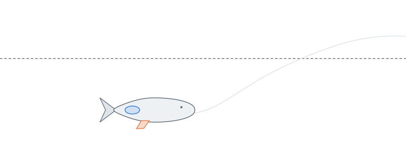

# swim-bladder-bifurcations

Code and data for the paper "Forward swimming can stabilize the depth of fish with a swim bladder without
active control" (N. A. Ismailov, V. V. Matrosov, S. A. Lobov, A. E. Hramov, V. B. Kazantsev).

The model describes longitudinal motion of a body with a swim bladder at constant forward speed $U$:
depth $z$ and pitch $\theta$. The bladder gives the force $F_A = k_b (z + r_A \sin\theta)$, the fins give
the lift $F_L = K U^2 \alpha$, where $\alpha = \theta - \arctan(\dot z / U)$:

$$m\ddot z = F_A + F_L\cos\gamma,\qquad J\ddot\theta = r_A\cos\theta\,F_A + r_L F_L\cos\alpha - k_\theta\theta.$$

Reference set: $m = J = K = 1$, $k_b = 0.5$, $k_\theta = 5$, $r_A = -4.6$ m; fin shift $d = r_L - r_L(B=0)$.
Fish-like set: $\kappa = k_b J/(m k_\theta) = 0.002$, $\beta = K\ell/m = 1$, $\rho_A = r_A/\ell = -0.5$.



## Installation

```bash
python -m venv .venv
source .venv/bin/activate
pip install -e .
```

`figures.py movie` needs ffmpeg; `figures.py gif` produces the same animation as a GIF.

## Contents

```
bladder/          model and numerical methods
  model.py        right-hand side, linearization, thresholds a4 = 0 and B = 0, pitchfork saddles
  normal_form.py  first Lyapunov coefficient, normal form at the Hopf-pitchfork point
  cycles.py       symmetric and asymmetric cycles (shooting), lines SB and TR
  attractors.py   settling, Poincare section, Lyapunov exponent, regime classification
scripts/          computations for the paper (run from the repository root)
data/             results
figures/          figures of the paper and Supplementary Movie 1
paper/            numbers.tex (numbers quoted in the text) and fish_table.tex (Table 2)
```

Fish morphology (`data/disanto2025/`) is taken from Di Santo et al. 2025, PNAS 122, e2420015122;
Dryad, doi:10.5061/dryad.9cnp5hqw7 (CC0).

## Reproduction

| Script | Output | Figure |
|---|---|---|
| `symmetric_branches.py` | `symmetric_branches.json`, `branch_U2.npy` | 5 |
| `corner.py` | `corner.json`, `sb_corner.npy`, `nf_lines.npy` | 6 |
| `sb_tr_lines.py` | `sb_line.npy`, `tr_line.npy` | 6 |
| `regime_map.py` | `regime_map.npy` | 6 |
| `hopf_sign.py` | `hopf_sign.json`, `l1_map.npz`: sign of $l_1$ on $B=0$ | — |
| `no_torus.py` | check of escape between $a_4=0$ and TR (console output) | 6 |
| `sweeps.py d_up` (and `d_down`, `d_zoom`, `U_down`, `U_up`) | `sweep_*.npz` | 7 |
| `fish_parameters.py` | `fish_parameters.json`: model parameters for fish from Di Santo et al. 2025 | Table 2 |
| `fish_prediction.py` | `fish_prediction.json`: $U_0$ is the lowest speed of passive stabilization | Methods |
| `fish_l1.py` | `fish_l1.npy`: sign of $l_1$ over the fish parameter range | — |
| `fish_corner.py` | `fish_corner.json`: Hopf-pitchfork point for the fish-like set | — |
| `fish_escape.py` | limit of bounded motion beyond $B=0$ for the fish-like set (long integration) | — |
| `stability_quadrants.py` | `stability_quadrants.json`: where the equilibrium can be stable | 3 |
| `paper_numbers.py` | `paper/numbers.tex`, `paper/fish_table.tex` | — |
| `figures.py` | `figures/*.pdf`, `*.png` | 1–7 |

The first two scripts and the figures take minutes; the regime map, the sweeps and `fish_escape.py` take
hours. `sb_tr_lines.py` and `regime_map.py` use all processor cores.

```bash
python scripts/corner.py
python scripts/figures.py s06
```

All results are stored in `data/`, so the figures and `numbers.tex` can be produced without the long runs.

Regime classes in `regime_map.npy` (third column): 0, equilibrium; 1, symmetric cycle; 2, asymmetric
cycle; 3, higher-period cycle; 4, not settled; 5, chaotic attractor; 6, no attractor.
